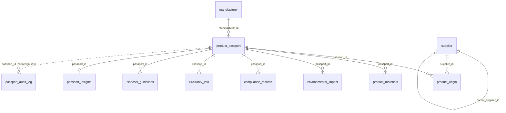

# Digital Product Passport (DPP): Database Dictionary

Schema: `dpp` on Lakebase (PostgreSQL-compatible). Tables: 12. Columns: 122.

This dictionary was written from four project files:

| File | What it defines |
|---|---|
| `01_setup_lakebase_schema.sql` | The real table definitions: column types, keys, constraints, indexes, the audit trigger and the grants |
| `02_synthetic_data_generator_1.py` | How each column is filled with synthetic data, including value ranges, probabilities and null rules |
| `03_seed_lakebase.py` | Load order, truncate order and the column list the seeder inserts |
| `00_setup_lakebase.py` | The setup job that applies the schema, generates data in memory and seeds it in one process |

Where the three disagree, the SQL file is treated as the truth about structure, and the generator as the truth about content. Section 9 lists the disagreements found.

---

## 1. Overview

### 1.1 Table groups

| Group | Tables | Filled by |
|---|---|---|
| Core entities | `manufacturer`, `supplier`, `product_passport` | Generator, then seeder |
| Passport detail (one passport, many detail rows) | `product_origin`, `product_materials`, `environmental_impact`, `compliance_records`, `circularity_info`, `disposal_guidelines` | Generator, then seeder |
| Change tracking | `passport_audit_log` | A database trigger (see 7.1) |
| Application support | `passport_insights`, `app_access_log` | Applications and jobs at run time, not the generator |

So ten tables are seeded from generated data, and two are written by the running system.

### 1.2 Synthetic data facts (battery profile)

| Item | Value |
|---|---|
| Fictional manufacturer | VoltCore Energy AB (Sweden), registration number SE556987-6543, website https://www.voltcore.se |
| Random seed | 42 (output is repeatable) |
| Product passports | 500 |
| Suppliers | 50 across 3 tiers |
| Reference date used for all "today" calculations | 2026-03-15 |
| Share of "complete" passports | About 90%. The other 10% have some optional columns set to NULL (see each table) |
| Battery categories | EV Battery, Industrial Battery, LMT Battery, Portable Battery |
| QR link pattern | `https://dpp.voltcore.se/passport/{passport_id}` |
| Document link pattern | `https://certs.voltcore.se/{8 digits}.pdf` |

The schema itself is domain-agnostic. The same tables are also filled with a furniture profile ("NordicForm AB"). Column descriptions below describe the battery profile unless stated.

### 1.3 Conventions used in all tables

| Convention | Meaning |
|---|---|
| Primary keys | UUID, created with `gen_random_uuid()` by default. The generator supplies its own seeded UUIDs, so rerunning gives the same IDs |
| Country columns | `VARCHAR(3)`, ISO 3166-1 alpha-3 codes such as `SWE`, `DEU`, `CHN` |
| Timestamps | `TIMESTAMPTZ` (with time zone). `created_at` and `updated_at` default to `now()` |
| Dates | `DATE` (no time part) |
| Percentages | Stored as numbers from 0 to 100, not as fractions |
| Lists | PostgreSQL `TEXT[]` arrays (`supplier.certifications`, `circularity_info.second_life_options`) |
| Flags | `BOOLEAN` |
| NULL | Means "not provided" (for example in incomplete passports), not "zero" or "no" |

---

## 2. Relationships



| Relationship | Type | Enforced by | Notes |
|---|---|---|---|
| `product_passport.manufacturer_id` to `manufacturer` | Many to one | Foreign key, NOT NULL | One manufacturer in the demo data |
| `supplier.parent_supplier_id` to `supplier.supplier_id` | Self-reference | Foreign key, nullable | Builds the tier chain. Tier 1 suppliers have no parent |
| `product_origin.passport_id` to `product_passport` | Many to one | Foreign key, NOT NULL | |
| `product_origin.supplier_id` to `supplier` | Many to one | Foreign key, NOT NULL | |
| `product_materials`, `environmental_impact`, `compliance_records`, `circularity_info`, `disposal_guidelines` to `product_passport` | Many to one | Foreign key on `passport_id`, NOT NULL | The generator creates exactly one `environmental_impact` and one `circularity_info` row per passport, although the schema would allow more |
| `passport_insights.passport_id` to `product_passport` | One to one | Primary key and foreign key together | |
| `passport_audit_log.passport_id` | Reference only | **No foreign key** | Audit history survives even if a passport is deleted |

None of the foreign keys uses `ON DELETE CASCADE`. Deleting a passport that still has child rows will fail. The seeder avoids this by using `TRUNCATE ... CASCADE`.

### 2.1 Load and truncate order (from the seeder)

Load order (parents first): `manufacturer`, `supplier`, `product_passport`, `product_origin`, `product_materials`, `environmental_impact`, `compliance_records`, `circularity_info`, `disposal_guidelines`, `passport_audit_log`.

Truncate order is the reverse. `passport_insights` and `app_access_log` are not in either list, so the seeder never loads or clears them.

### 2.2 Expected row counts

These are estimates worked out from the generator logic, not counts taken from a running database.

| Table | Expected rows | Basis |
|---|---|---|
| `manufacturer` | 1 | One fixed record |
| `supplier` | 50 | `NUM_SUPPLIERS` |
| `product_passport` | 500 | `NUM_PRODUCTS` |
| `product_origin` | About 1,500 | 1 to 5 draws per passport; a repeat supplier within a passport is skipped |
| `product_materials` | About 2,500 | 2 to 8 per passport (11 materials available) |
| `environmental_impact` | 500 | Exactly 1 per passport |
| `compliance_records` | About 2,500 | 1 to 3 random regulations plus 3 always-pending phased records, so 4 to 6 per passport |
| `circularity_info` | 500 | Exactly 1 per passport |
| `disposal_guidelines` | About 1,000 to 1,200 | 1 to the number of components for the category (EV 4, Industrial 3, LMT 3, Portable 2) |
| `passport_audit_log` | Created by triggers | See 7.1 |
| `passport_insights`, `app_access_log` | Filled at run time | |

---

## 3. Table index

| # | Table | Columns | One row means | Primary key |
|---|---|---|---|---|
| 1 | `manufacturer` | 7 | A company that places products on the market | `manufacturer_id` |
| 2 | `supplier` | 11 | A company in the supply chain, at tier 1, 2 or 3 | `supplier_id` |
| 3 | `product_passport` | 15 | One product (one battery) and its passport | `passport_id` |
| 4 | `product_origin` | 10 | One component of one product and the supplier it came from | `origin_id` |
| 5 | `product_materials` | 11 | One material in one product's composition | `material_id` |
| 6 | `environmental_impact` | 13 | Carbon and resource footprint of one product | `impact_id` |
| 7 | `compliance_records` | 11 | One regulation status for one product | `compliance_id` |
| 8 | `circularity_info` | 14 | Durability, repair, recycling and health data for one product | `circularity_id` |
| 9 | `disposal_guidelines` | 9 | End-of-life instructions for one component of one product | `disposal_id` |
| 10 | `passport_audit_log` | 8 | One recorded change to a passport-related row | `log_id` |
| 11 | `passport_insights` | 4 | The cached AI analysis for one passport | `passport_id` |
| 12 | `app_access_log` | 9 | One recorded page or API access by a user | `access_id` |

---

## 4. Core entity tables

### 4.1 `manufacturer`

**Purpose:** the company that makes the product and owns the passport.

**Generated:** one row, taken from the profile. Both timestamps are fixed at 2024-01-15 09:00 UTC.

| Column | Type | Null | Default / constraint | Description | Generated value |
|---|---|---|---|---|---|
| `manufacturer_id` | UUID | No | Primary key, `gen_random_uuid()` | Unique ID of the manufacturer | Seeded UUID |
| `name` | VARCHAR(255) | No | | Legal name | `VoltCore Energy AB` |
| `country` | VARCHAR(3) | No | | Country of registration (alpha-3) | `SWE` |
| `registration_number` | VARCHAR(100) | Yes | | Company registration number | `SE556987-6543` |
| `website` | VARCHAR(500) | Yes | | Company website | `https://www.voltcore.se` |
| `created_at` | TIMESTAMPTZ | No | `now()` | Row creation time | 2024-01-15 09:00 UTC |
| `updated_at` | TIMESTAMPTZ | No | `now()` | Last change time | 2024-01-15 09:00 UTC |

**Not in the table:** postal address, email, trade name or trademark, and any "responsible operator" identity separate from the manufacturer.

---

### 4.2 `supplier`

**Purpose:** every company in the supply chain, modelled as a tree: a tier N supplier points to the tier N-1 supplier it delivers to, and the chain walks up to the manufacturer.

**Indexes:** `idx_supplier_country` (country), `idx_supplier_tier` (tier), `idx_supplier_parent` (parent_supplier_id).

| Column | Type | Null | Default / constraint | Description | Generated value |
|---|---|---|---|---|---|
| `supplier_id` | UUID | No | Primary key | Unique supplier ID | Seeded UUID |
| `name` | VARCHAR(255) | No | | Supplier name | Random company name from the Faker library (Swedish and US locales) |
| `country` | VARCHAR(3) | No | | Supplier's country | Random from `SWE, FIN, NOR, DNK, DEU, POL, LTU, LVA, EST, CZE, PRT, ITA, CHN, IND, VNM` |
| `tier` | INT | No | CHECK 1 to 3 | Position in the chain. 1 is a direct supplier, 3 is the deepest (raw materials) | Random with weights 40% / 35% / 25%. At least one supplier exists in every tier |
| `parent_supplier_id` | UUID | Yes | Foreign key to `supplier` | The supplier one tier closer to the manufacturer | NULL for tier 1. Otherwise a random supplier from the tier above |
| `risk_score` | DECIMAL(3,1) | Yes | CHECK 0.0 to 10.0 | Supplier risk rating (higher means riskier) | Random 1.0 to 9.5, one decimal |
| `certifications` | TEXT[] | Yes | | List of certifications the supplier holds | 1 to 4 random values from `CE, UN 38.3, IEC 62133, IEC 62619, UL 2580, ISO 14001, OECD Due Diligence, EU Battery Passport` |
| `last_audit_date` | DATE | Yes | | Date of the last audit | 85%: 30 to 365 days before 2026-03-15. 15%: a date up to 30 days after it (used to test "audit expiring" alerts) |
| `active` | BOOLEAN | No | `TRUE` | Whether the supplier is currently active | About 95% true |
| `created_at` | TIMESTAMPTZ | No | `now()` | Row creation time | 2024-01-15 |
| `updated_at` | TIMESTAMPTZ | No | `now()` | Last change time | 2024-06-01 |

**Notes:**
- A tier 2 supplier's parent is always a tier 1 supplier, and a tier 3 supplier's parent is a tier 2 supplier, so a chain can be walked with a recursive query.
- `risk_score` is random, not a calculated assessment.
- Certifications are random picks and are not linked to what the supplier actually delivers.

---

### 4.3 `product_passport`

**Purpose:** the core record. One row is one product with its identity and status. All detail tables point to it.

**Indexes:** `idx_passport_product_id`, `idx_passport_gtin`, `idx_passport_category`, `idx_passport_status`. A unique constraint `uq_product_id` also exists on `product_id`.

| Column | Type | Null | Default / constraint | Description | Generated value |
|---|---|---|---|---|---|
| `passport_id` | UUID | No | Primary key | Unique ID of the passport; also used in the QR link | Seeded UUID |
| `product_id` | VARCHAR(50) | No | UNIQUE | Business product code (SKU) | `VC-<PREFIX>-<number>`, for example `VC-VOLT-001`. The number counts up per prefix, so it never repeats |
| `gtin` | VARCHAR(14) | Yes | | Global Trade Item Number | Random 14-digit number (not a valid GTIN: no check digit) |
| `serial_number` | VARCHAR(100) | Yes | | Serial number of the unit | `SN` plus 8 characters. NULL for incomplete passports |
| `batch_lot_number` | VARCHAR(100) | Yes | | Production batch | `LOT-<year 2024 to 2026>-<week 01 to 52>` |
| `product_name` | VARCHAR(255) | No | | Display name | Upper-case `<PREFIX> <TYPE> <STYLE>`, for example `VOLT EV PACK 800V`. A number is appended if the name is already used |
| `product_category` | VARCHAR(100) | No | | Battery category | `EV Battery`, `Industrial Battery`, `LMT Battery` or `Portable Battery`, picked at random across 12 product types |
| `manufacturer_id` | UUID | No | Foreign key to `manufacturer` | Owner of the passport | The single manufacturer |
| `production_date` | DATE | Yes | | Date of manufacture | 1 to 730 days before 2026-03-15 |
| `production_facility` | VARCHAR(255) | Yes | | Plant where it was made | One of five VoltCore sites (Skelleftea, Gdansk, Kaunas, Hamburg, Norrkoping). NULL if incomplete |
| `country_of_origin` | VARCHAR(3) | Yes | | Country of origin | `SWE`, `DEU` or `POL`. NULL if incomplete. Not linked to the facility |
| `passport_status` | VARCHAR(20) | No | `'draft'`; CHECK in `draft, active, expired, revoked` | Lifecycle state of the passport record | Weights: active 78%, draft 13%, expired 5%, revoked 2% |
| `qr_code_url` | TEXT | Yes | | Link encoded in the QR code | `https://dpp.voltcore.se/passport/{passport_id}`. NULL if incomplete |
| `created_at` | TIMESTAMPTZ | No | `now()` | Creation time | 1 to 30 days before production date |
| `updated_at` | TIMESTAMPTZ | No | `now()` | Last change time | `created_at` plus 0 to 60 days |

**Product types (12), by category:**

| Category | Prefix and type |
|---|---|
| EV Battery | VOLT EV Pack, NMCE NMC Module, LFPX LFP Pack, NCAE NCA Module |
| Industrial Battery | ESSR ESS Rack, GRID Grid Module, UPSX UPS Battery |
| LMT Battery | EBIK E-Bike Pack, ESCO E-Scooter Pack |
| Portable Battery | PWRX Power Tool Pack, CY70 21700 Cell, POUC Pouch Cell |

**Style modifiers (12):** 48V, 400V, 800V, LFP, NMC811, NCA, Long-Range, Fast-Charge, High-Density, Gen2, Gen3, Standard.

**Notes:**
- `passport_status` describes the **record**, not the battery's own lifecycle state.
- The table holds no battery specification fields (capacity, voltage, weight, chemistry code, power). Chemistry only appears inside `product_name` and, indirectly, in `product_materials`.
- The category list is a free text field with no CHECK constraint.

---

### 4.4 `product_origin`

**Purpose:** traceability. Each row links a passport to one supplier and the component that supplier provided.

**Indexes:** `idx_origin_passport`, `idx_origin_supplier`.

| Column | Type | Null | Default / constraint | Description | Generated value |
|---|---|---|---|---|---|
| `origin_id` | UUID | No | Primary key | Unique ID | Seeded UUID |
| `passport_id` | UUID | No | Foreign key to `product_passport` | The product | |
| `supplier_id` | UUID | No | Foreign key to `supplier` | The supplier of this component | Random from all 50 suppliers; a supplier is used at most once per passport |
| `supply_chain_tier` | INT | No | | Tier of that supplier | Copied from `supplier.tier` |
| `component_name` | VARCHAR(255) | No | | Component or material supplied | Depends on tier (see below) |
| `source_country` | VARCHAR(3) | Yes | | Country the component came from | Copied from `supplier.country` |
| `source_region` | VARCHAR(255) | Yes | | Region or city | Random city name. NULL if incomplete |
| `certification` | VARCHAR(255) | Yes | | A certification claimed for this component | Random from the 8 battery certifications |
| `certification_expiry` | DATE | Yes | | When that certification expires | 12%: 1 to 30 days after 2026-03-15. 88%: 90 to 730 days after it |
| `traceability_proof` | TEXT | Yes | | Reference to proof of origin | `TRACE-XXXX-####`. NULL if incomplete |

**Components by tier:**

| Tier | Components the generator can assign |
|---|---|
| 3 (raw materials) | Lithium (raw material), Cobalt (raw material), Natural graphite (raw material), Nickel (raw material), Manganese ore |
| 2 (cell level) | Cathode active material, Anode active material, Electrolyte, Separator, Battery cell |
| 1 (module and pack level) | Battery module, Cell-to-pack assembly, Battery management system (BMS), Busbar / interconnect, Pack housing |

**Notes:**
- Suppliers are picked at random, so the chain in one passport does not follow a real path (for example, a tier 3 supplier may be picked without its parent chain being in the same passport).
- `certification` is not checked against the supplier's own `certifications` list.
- There is no field for the mine, smelter or refiner, or for the quantity supplied.

---

## 5. Passport detail tables

### 5.1 `product_materials`

**Purpose:** the material composition (bill of materials) of one product.

**Index:** `idx_materials_passport`.

| Column | Type | Null | Default / constraint | Description | Generated value |
|---|---|---|---|---|---|
| `material_id` | UUID | No | Primary key | Unique ID | Seeded UUID |
| `passport_id` | UUID | No | Foreign key to `product_passport` | The product | |
| `material_name` | VARCHAR(255) | No | | Name of the material | One of 11 battery materials (list below) |
| `material_category` | VARCHAR(100) | Yes | | Group the material belongs to | Active Material, Electrolyte, Current Collector, Separator or Metal |
| `percentage_by_weight` | DECIMAL(5,2) | No | CHECK 0 to 100 | Share of the product's weight | Random shares of 2 to 8 materials, adjusted so the total is exactly 100 |
| `recycled_content_pct` | DECIMAL(5,2) | Yes | CHECK 0 to 100 | Recycled share of this material | 30% of rows: random 0 to 80. Otherwise 0.0 |
| `renewable_flag` | BOOLEAN | Yes | `FALSE` | Whether the material is renewable | From the material list; false for all battery materials |
| `hazardous_flag` | BOOLEAN | Yes | `FALSE` | Whether the material is flagged hazardous | From the material list |
| `cas_number` | VARCHAR(20) | Yes | | Chemical Abstracts Service registry number | From the material list; NULL for the polymer separator |
| `reach_compliant` | BOOLEAN | Yes | `TRUE` | REACH compliance flag | Always true |
| `svhc_flag` | BOOLEAN | Yes | `FALSE` | Substance of very high concern flag | Always false |

**Material list used by the generator (all four categories share it):**

| Material | Category | CAS number | Hazardous flag |
|---|---|---|---|
| Lithium Carbonate | Active Material | 554-13-2 | No |
| Cobalt Oxide | Active Material | 1307-96-6 | Yes |
| Nickel Sulfate | Active Material | 7786-81-4 | Yes |
| Manganese Oxide | Active Material | 1313-13-9 | No |
| Graphite Anode | Active Material | 7782-42-5 | No |
| Lithium Iron Phosphate | Active Material | 15365-14-7 | No |
| Electrolyte (LiPF6) | Electrolyte | 21324-40-3 | Yes |
| Copper Foil | Current Collector | 7440-50-8 | No |
| Aluminium Foil | Current Collector | 7429-90-5 | No |
| Polymer Separator | Separator | none | No |
| Steel Casing | Metal | 7439-89-6 | No |

**Notes:**
- Materials are chosen at random, so a product named "LFP" can contain cobalt oxide. The composition is not tied to the chemistry in the product name.
- Materials are whole compounds, not elements, so shares of cobalt, lithium, nickel or lead cannot be read from this table.
- `recycled_content_pct` here is generated independently of `circularity_info.recycled_content_pct`, so the two values for one product will not match.
- `reach_compliant` and `svhc_flag` carry constant values and hold no real information yet.

---

### 5.2 `environmental_impact`

**Purpose:** the carbon footprint and resource use of one product, with its split by life-cycle phase.

**Index:** `idx_impact_passport`.

| Column | Type | Null | Default / constraint | Description | Generated value |
|---|---|---|---|---|---|
| `impact_id` | UUID | No | Primary key | Unique ID | Seeded UUID |
| `passport_id` | UUID | No | Foreign key to `product_passport` | The product | One row per product |
| `carbon_footprint_kg` | DECIMAL(10,3) | Yes | | Total carbon footprint in kg CO2e | Random within the category range (below) |
| `carbon_manufacturing` | DECIMAL(10,3) | Yes | | Part from manufacturing | Total times manufacturing share |
| `carbon_transport` | DECIMAL(10,3) | Yes | | Part from transport | Total times transport share |
| `carbon_use_phase` | DECIMAL(10,3) | Yes | | Part from the use phase | Total times use-phase share |
| `carbon_end_of_life` | DECIMAL(10,3) | Yes | | Part from end of life | Total times end-of-life share |
| `energy_consumption_kwh` | DECIMAL(10,3) | Yes | | Energy used | Random 5 to 500 |
| `water_usage_liters` | DECIMAL(10,3) | Yes | | Water used | Random 10 to 2,000 |
| `lca_methodology` | VARCHAR(100) | Yes | | Life-cycle assessment method used | Random from `ISO 14040/14044`, `PEF (Product Environmental Footprint)`, `EPD (Environmental Product Declaration)`, `GHG Protocol Product Standard`. NULL if incomplete |
| `lca_data_source` | VARCHAR(255) | Yes | | Database the figures came from | `VoltCore Battery LCA Database v2.0`. NULL if incomplete |
| `assessment_date` | DATE | Yes | | Date of the assessment | 30 to 365 days before 2026-03-15 |
| `verified_by` | VARCHAR(255) | Yes | | Body that verified the assessment | Random from the eight issuing bodies (below). NULL if incomplete |

**Carbon footprint ranges and phase shares by category:**

| Category | Total range (kg CO2e) | Manufacturing | Transport | Use phase | End of life |
|---|---|---|---|---|---|
| EV Battery | 2,000 to 8,000 | 55 to 70% | 5 to 10% | 18 to 32% | 4 to 10% |
| Industrial Battery | 500 to 3,500 | 50 to 65% | 5 to 10% | 22 to 35% | 4 to 10% |
| LMT Battery | 40 to 300 | 55 to 70% | 6 to 12% | 12 to 25% | 5 to 12% |
| Portable Battery | 3 to 60 | 60 to 75% | 6 to 12% | 8 to 18% | 5 to 12% |

The four phase shares are drawn in these ranges and then scaled so they add up to 100% of the total.

**Issuing and verifying bodies (8):** TUV Rheinland, Bureau Veritas, SGS SA, Intertek, DNV GL, RISE (Sweden), VTT (Finland), SP Technical Research.

**Notes:**
- The footprint is one total in kg CO2e. It is not expressed per kWh of energy delivered.
- The phases are manufacturing, transport, use and end of life. The table does not hold a life-cycle stage for raw material acquisition.
- `energy_consumption_kwh` and `water_usage_liters` are random and unrelated to the carbon values.
- Per the generator comments, the Batteries Regulation carbon footprint declaration is not required at the 18 February 2027 passport launch; the compliance table marks it pending.

---

### 5.3 `compliance_records`

**Purpose:** one row per regulation or certificate status for a product.

**Indexes:** `idx_compliance_passport`, `idx_compliance_status`.

| Column | Type | Null | Default / constraint | Description | Generated value |
|---|---|---|---|---|---|
| `compliance_id` | UUID | No | Primary key | Unique ID | Seeded UUID |
| `passport_id` | UUID | No | Foreign key to `product_passport` | The product | |
| `regulation_name` | VARCHAR(255) | No | | Name of the regulation | From the regulation list (below) |
| `regulation_version` | VARCHAR(50) | Yes | | Version or reference number | From the regulation list |
| `compliance_status` | VARCHAR(20) | No | CHECK in `compliant, pending, non_compliant, expired` | Current status | See distribution below |
| `certificate_ref` | VARCHAR(255) | Yes | | Certificate number | `CERT-XXXX-####` only when status is `compliant`; otherwise NULL |
| `issuing_body` | VARCHAR(255) | Yes | | Body that issued it | Random from the eight issuing bodies. NULL if incomplete |
| `issue_date` | DATE | Yes | | Date of issue | 30 to 730 days before 2026-03-15. NULL for phased records |
| `expiry_date` | DATE | Yes | | Date it expires | Issue date plus 365 to 1,095 days. NULL for phased records |
| `document_url` | TEXT | Yes | | Link to the document | `https://certs.voltcore.se/<8 digits>.pdf` only when `compliant`; otherwise NULL |
| `notes` | TEXT | Yes | | Free-text note | `Pending lab results` when pending; for phased records, the applicability note |

**Two kinds of rows are generated for every battery:**

1. **Regular records:** 1 to 3 regulations chosen at random from the list below. Status: 85% `compliant`, 10% `pending`, 5% `non_compliant`.
2. **Phased records (always 3):** requirements that exist in the Batteries Regulation but do not apply at the 18 February 2027 launch. They are always `pending`, with all other columns NULL except `notes`.

**Regular regulations (5):**

| Name | Version |
|---|---|
| EU Batteries Regulation | 2023/1542 |
| ESPR - Ecodesign for Sustainable Products | 2024/1781 |
| UN 38.3 Transport of Dangerous Goods | Rev.7 |
| EU REACH Regulation | EC 1907/2006 |
| EU RoHS Directive | 2011/65/EU |

**Phased records (3):**

| Name | Version | Note stored in `notes` |
|---|---|---|
| Battery Carbon Footprint Declaration | 2023/1542 Art.7 | Not required at the 18 Feb 2027 launch; applies from a later date set by delegated act |
| Recycled Content Share | 2023/1542 Art.8 | Not required at launch; minimum recycled-content documentation applies from a later date |
| Supply Chain Due Diligence | 2023/1542 Art.48 | Due diligence report required at the latest by 18 Aug 2028 |

**Notes:**
- The status `expired` is allowed by the constraint but the generator never writes it, even though `expiry_date` is often in the past relative to 2026-03-15.
- A product gets a random subset of regulations. It will not have a record for every regulation that applies.
- The Due Diligence note stores the date 18 Aug 2028. Current sources give 18 August 2027 (Regulation (EU) 2025/1561), so this text needs correcting.
- Records are attached per passport (per individual product), not per battery model.

---

### 5.4 `circularity_info`

**Purpose:** durability, repair, recycling and, for rechargeable batteries, health data of one product.

**Index:** `idx_circularity_passport`.

| Column | Type | Null | Default / constraint | Description | Generated value |
|---|---|---|---|---|---|
| `circularity_id` | UUID | No | Primary key | Unique ID | Seeded UUID |
| `passport_id` | UUID | No | Foreign key to `product_passport` | The product | One row per product |
| `durability_years` | INT | Yes | | Expected service life in years | Random within the category range (below) |
| `repairability_score` | DECIMAL(3,1) | Yes | CHECK 0 to 10 | Ease of repair, 0 to 10 | Random 2.0 to 9.5 |
| `spare_parts_available` | BOOLEAN | Yes | `FALSE` | Whether spare parts exist | About 70% true |
| `spare_parts_years` | INT | Yes | | Years spare parts stay available | Random 5 to 15. NULL if incomplete |
| `refurbishable` | BOOLEAN | Yes | `FALSE` | Whether it can be refurbished | About 60% true |
| `recycled_content_pct` | DECIMAL(5,2) | Yes | CHECK 0 to 100 | Overall recycled share | Random 0 to 60 |
| `recyclability_pct` | DECIMAL(5,2) | Yes | CHECK 0 to 100 | Share that can be recycled | Random 40 to 98 |
| `take_back_program` | BOOLEAN | Yes | `FALSE` | Whether a take-back scheme exists | About 50% true |
| `second_life_options` | TEXT[] | Yes | | Possible second-life uses | 1 to 4 of: grid storage repurposing, second-life ESS, cell harvesting, material recovery (hydrometallurgy), refurbishment service, cascaded reuse |
| `state_of_health_pct` | DECIMAL(5,2) | Yes | CHECK 0 to 100 | Battery state of health | Random 72.0 to 100.0 for rechargeable categories; NULL for Portable |
| `cycle_count` | INT | Yes | | Charge and discharge cycles so far | Random 50 to 3,000 for rechargeable categories; NULL for Portable |
| `dynamic_data_updated_at` | TIMESTAMPTZ | Yes | | When the two dynamic values were last updated | 0 to 7 days before 2026-03-15 (midnight UTC); NULL for Portable |

**Durability range by category (years):** EV Battery 8 to 15, Industrial Battery 10 to 20, LMT Battery 3 to 8, Portable Battery 2 to 6.

**Notes:**
- The three dynamic columns are marked in the schema as dynamic data from Articles 10 and 14 of the Batteries Regulation, and are only filled for EV, Industrial and LMT batteries. Portable batteries are treated as not rechargeable with a battery management system.
- These three columns hold one value each. They are overwritten on update, not stored as a history (the audit log keeps old values).
- The three columns were added by an additive migration (`ALTER TABLE ... ADD COLUMN IF NOT EXISTS`), so older deployments get them without recreating the table.
- `recycled_content_pct` here is independent of the per-material value in `product_materials`.
- `spare_parts_available` can be false while `spare_parts_years` holds a number; the two are generated independently.

---

### 5.5 `disposal_guidelines`

**Purpose:** end-of-life handling instructions, one row per component of a product.

**Index:** `idx_disposal_passport`.

| Column | Type | Null | Default / constraint | Description | Generated value |
|---|---|---|---|---|---|
| `disposal_id` | UUID | No | Primary key | Unique ID | Seeded UUID |
| `passport_id` | UUID | No | Foreign key to `product_passport` | The product | |
| `component_name` | VARCHAR(255) | No | | Component being disposed of | From the category's component list (below) |
| `disposal_method` | VARCHAR(100) | Yes | | How to dispose of it | From the same list |
| `disassembly_steps` | TEXT | Yes | | Steps to take it apart | Template: "1. Remove <component> using standard tools. 2. Separate from other components. 3. Clean if necessary before disposal." |
| `recycling_code` | VARCHAR(20) | Yes | | Waste or material code | From the component list; NULL for electronics |
| `local_collection_info` | TEXT | Yes | | Where to hand it in | Constant: "Check local municipality recycling guidelines." |
| `special_handling` | TEXT | Yes | | Safety note | "Wear protective gloves during disassembly." when the method contains "Hazardous" or "Electronics"; otherwise NULL |
| `weight_kg` | DECIMAL(8,3) | Yes | | Weight of this component | Random within the range in the list |

**Components by category (component, method, code, weight range in kg):**

| Category | Component | Method | Code | Weight (kg) |
|---|---|---|---|---|
| EV Battery | Battery Cells | Hazardous waste collection | 16 06 01 | 80 to 400 |
| EV Battery | BMS Electronics | Electronics recycling (WEEE) | none | 1 to 5 |
| EV Battery | Pack Housing | Specialized recycling center | 41 ALU | 10 to 60 |
| EV Battery | Cooling System | Specialized recycling center | 40 FE | 5 to 30 |
| Industrial Battery | Battery Modules | Hazardous waste collection | 16 06 01 | 30 to 200 |
| Industrial Battery | Rack Frame | Specialized recycling center | 40 FE | 10 to 80 |
| Industrial Battery | Power Electronics | Electronics recycling (WEEE) | none | 2 to 10 |
| LMT Battery | Cell Pack | Hazardous waste collection | 16 06 01 | 1 to 8 |
| LMT Battery | BMS Board | Electronics recycling (WEEE) | none | 0.05 to 0.3 |
| LMT Battery | Casing | Municipal recycling | 5 PP | 0.2 to 1 |
| Portable Battery | Cells | Hazardous waste collection | 16 06 01 | 0.05 to 2 |
| Portable Battery | Casing | Municipal recycling | 5 PP | 0.02 to 0.3 |

**Notes:**
- The disassembly text is the same template for every component, and the collection info is a constant, so these columns hold placeholder text.
- `weight_kg` is the weight of one component. It is not the weight of the whole battery.
- The code `16 06 01` is used for all cell components; this European Waste Catalogue code is, as far as we know, assigned to lead batteries. Lithium-ion batteries are normally under `16 06 05`. Verify against the catalogue before relying on it.

---

## 6. System tables

### 6.1 `passport_audit_log`

**Purpose:** a record of every insert, update and delete on passport-related tables, with the row's values before and after the change.

**Indexes:** `idx_audit_passport` (passport_id), `idx_audit_timestamp` (changed_at).

| Column | Type | Null | Default / constraint | Description |
|---|---|---|---|---|
| `log_id` | UUID | No | Primary key, `gen_random_uuid()` | Unique ID of the log entry |
| `passport_id` | UUID | Yes | **No foreign key** | The passport the changed row belongs to. Kept even if the passport is later deleted |
| `table_name` | VARCHAR(100) | No | | Name of the table that changed (for example `product_passport`) |
| `action` | VARCHAR(10) | No | CHECK in `INSERT, UPDATE, DELETE` | Type of change |
| `changed_by` | VARCHAR(255) | Yes | | Database role that made the change (`current_user`) |
| `changed_at` | TIMESTAMPTZ | No | `now()` | When the change happened |
| `old_values` | JSONB | Yes | | The whole row before the change (NULL for INSERT) |
| `new_values` | JSONB | Yes | | The whole row after the change (NULL for DELETE) |

**How it is filled:** by the trigger described in 7.1, not by the generator. The generator keeps an empty `audit_log` list that nothing writes to, so the seeder has no records to load for this table.

---

### 6.2 `passport_insights`

**Purpose:** a cache of AI-generated analysis for each passport, so the Passport Viewer does not call the model on every page view.

| Column | Type | Null | Default / constraint | Description |
|---|---|---|---|---|
| `passport_id` | UUID | No | Primary key and foreign key to `product_passport` | The passport the insights belong to (one row per passport) |
| `insights_json` | TEXT | No | | The analysis as JSON text, shaped as `{gaps, carbon_analysis, compliance_alerts, circularity_recommendations}` |
| `model` | VARCHAR(255) | Yes | | Name of the model that produced it |
| `generated_at` | TIMESTAMPTZ | No | `now()` | When it was produced |

**How it is filled:** by the nightly `precompute_insights` job, which runs a model query (`ai_query`) over the Gold layer. It is not created by the generator or seeder, and it is not covered by the audit trigger. `insights_json` is TEXT, not JSONB, so it is not queryable by key without a cast.

---

### 6.3 `app_access_log`

**Purpose:** optional usage tracking of who opens the Passport Viewer and Supplier Portal.

**Indexes:** `idx_access_email`, `idx_access_time`.

| Column | Type | Null | Default / constraint | Description |
|---|---|---|---|---|
| `access_id` | UUID | No | Primary key, `gen_random_uuid()` | Unique ID of the access event |
| `user_email` | VARCHAR(320) | Yes | | Email of the signed-in user |
| `user_name` | VARCHAR(255) | Yes | | Name of the signed-in user |
| `app_name` | VARCHAR(100) | Yes | | Which application was used |
| `path` | TEXT | Yes | | The page or API path requested |
| `method` | VARCHAR(10) | Yes | | HTTP method (GET, POST and so on) |
| `client_ip` | VARCHAR(64) | Yes | | Client IP address |
| `user_agent` | TEXT | Yes | | Browser or client string |
| `accessed_at` | TIMESTAMPTZ | No | `now()` | When the request happened |

**How it is filled:** by the applications, only when `ACCESS_LOG_ENABLED=true`. A deployed Databricks App sits behind single sign-on and passes the user's identity in forwarded headers, which is where the email and name come from.

**Privacy note:** this table holds personal data (email, name, IP address) and falls under GDPR. The schema comments recommend leaving it disabled unless internal usage tracking is needed. It has no `passport_id`, so it is not covered by the audit trigger.

---

## 7. Database objects beyond the tables

### 7.1 Audit trigger

A function `dpp.audit_trigger_func()` runs `AFTER INSERT OR UPDATE OR DELETE ... FOR EACH ROW` and writes one row to `passport_audit_log` for each change.

| Operation | `old_values` | `new_values` |
|---|---|---|
| INSERT | NULL | The new row |
| UPDATE | The row before | The row after |
| DELETE | The row before | NULL |

**Tables with the trigger (7):** `product_passport`, `product_origin`, `product_materials`, `environmental_impact`, `compliance_records`, `circularity_info`, `disposal_guidelines`.

**Tables without it:** `manufacturer`, `supplier`, `passport_audit_log`, `passport_insights`, `app_access_log`. Changes to suppliers and the manufacturer are therefore not written to the audit log by this trigger.

**Behaviour to know:**
- `TRUNCATE` does not fire row triggers, so clearing tables before a reseed writes no audit entries. The seeder also truncates `passport_audit_log` itself, so a reseed starts with an empty log.
- Ordinary `INSERT` statements do fire the trigger. So when the seeder inserts the generated rows into the seven tables, the trigger is expected to write one `INSERT` audit entry per row, with `changed_by` set to the seeding role. This follows from how triggers work; check it by counting rows in `passport_audit_log` after a seed.

### 7.2 Extension

`pgcrypto` is enabled so that `gen_random_uuid()` is available.

### 7.3 Access grants

| Setting | What it does |
|---|---|
| `GRANT USAGE ON SCHEMA dpp TO PUBLIC` | Lets every database role see the schema |
| `GRANT SELECT, INSERT, UPDATE, DELETE ON ALL TABLES ... TO PUBLIC` and matching default privileges | Lets every role read and write every table, including tables created later |

This is marked in the SQL file as **demo-grade**. In production the file recommends granting only what each application's role needs: read access for the Viewer, and read plus insert and update on the writable tables for the Supplier Portal.

### 7.4 Idempotency

`CREATE TABLE IF NOT EXISTS`, `CREATE INDEX IF NOT EXISTS` and `ADD COLUMN IF NOT EXISTS` let the schema script be run repeatedly. The seeder truncates every table in reverse foreign-key order before inserting, so a reseed replaces data and does not add to it. The setup file warns not to rerun it against data that must be kept.

---

## 8. Quick reference: columns with restricted values

| Table | Column | Allowed values | Enforced by |
|---|---|---|---|
| `supplier` | `tier` | 1, 2, 3 | CHECK constraint |
| `supplier` | `risk_score` | 0.0 to 10.0 | CHECK constraint |
| `product_passport` | `passport_status` | draft, active, expired, revoked | CHECK constraint |
| `product_passport` | `product_category` | EV Battery, Industrial Battery, LMT Battery, Portable Battery | Generator only (no database constraint) |
| `product_materials` | `percentage_by_weight` | 0 to 100 | CHECK constraint |
| `product_materials` | `recycled_content_pct` | 0 to 100 | CHECK constraint |
| `compliance_records` | `compliance_status` | compliant, pending, non_compliant, expired | CHECK constraint |
| `circularity_info` | `repairability_score` | 0 to 10 | CHECK constraint |
| `circularity_info` | `recycled_content_pct`, `recyclability_pct`, `state_of_health_pct` | 0 to 100 | CHECK constraint |
| `passport_audit_log` | `action` | INSERT, UPDATE, DELETE | CHECK constraint |

---

## 9. Observations and inconsistencies found

These come from comparing the four files. None stops the system working, but each is worth knowing.

| # | Observation | Where | Why it matters |
|---|---|---|---|
| 1 | The setup job defaults to the **furniture** profile (`DPP_PROFILE` or `furniture`), while the generator's own default is **battery** | `00_setup_lakebase.py` vs `02_synthetic_data_generator_1.py` | If the job runs without `--profile battery`, furniture data loads. Confirm what the bundle passes |
| 2 | The README names the table `product_disposal`; the schema and code use `disposal_guidelines` | README vs SQL | Use `disposal_guidelines` in documents |
| 3 | The generator's header and docstring describe a furniture manufacturer "NordicForm" | Generator header | Outdated for the battery profile |
| 4 | The seeder's docstring says it reads JSON files, but the setup job seeds directly from memory | `03_seed_lakebase.py` vs `00_setup_lakebase.py` | Both paths exist; the in-memory path is the one the job uses |
| 5 | The generator's `audit_log` list is never filled | Generator | The audit table content comes only from the trigger |
| 6 | Status `expired` is allowed for compliance records but never generated, although many `expiry_date` values are before 2026-03-15 | Generator | Expiry is not reflected in the status |
| 7 | Recycled content is generated twice (`product_materials` and `circularity_info`) with no link between them | Generator | The two numbers for one product disagree |
| 8 | Materials are random picks from one shared list, so the composition does not match the chemistry in the product name | Generator | Composition values should not be treated as accurate |
| 9 | `reach_compliant` is always true and `svhc_flag` is always false | Generator | These columns carry no information yet |
| 10 | The due diligence note says "18 Aug 2028" | Generator, phased records | Current sources say 18 August 2027 |
| 11 | `product_category` has no database constraint and includes Portable Battery | SQL and generator | Free text can drift; portable batteries are outside the mandatory passport scope but are kept for completeness |
| 12 | `passport_status` is the record state, not the battery lifecycle status | SQL | Name is easy to confuse with the battery status the passport requires |
| 13 | GTIN is a random 14-digit number without a check digit | Generator | Not a valid GTIN |
| 14 | Dynamic values (`state_of_health_pct`, `cycle_count`) are single values, not time series | SQL | History exists only through the audit log |
| 15 | Grants are open to PUBLIC | SQL | Acceptable for a demo only |
| 16 | The waste code `16 06 01` is used for lithium-ion cell components | Generator | Likely the lead-battery code; verify against the European Waste Catalogue |

---

## 10. Where passport data points live

This is a pointer only. The full comparison with the 71 data points is in the separate document "Battery Passport: the 71 Data Points Compared with the DPP Project's Data Model".

| Table | Data points it relates to (guidance numbering) |
|---|---|
| `manufacturer` | 3 (name), 5 (website) |
| `product_passport` | 1 (identifier), 6 (category), 7 (model, batch, serial), 8 (place of manufacture), 9 (date of manufacture) |
| `product_materials` | 12 (chemistry), 13 (hazardous substances), 15 (critical raw materials), 24 (renewable share), 46 (detailed composition) |
| `environmental_impact` | 17 (carbon footprint; not required at launch) |
| `product_origin`, `supplier` | 19 (responsible sourcing; not required at launch), 47 (spare-part sources) |
| `compliance_records` | 43 (declaration of conformity), 50 (test reports) |
| `circularity_info` | 52 and 60 (partly), 68 (cycle count) |
| `disposal_guidelines` | 44 (waste information), 48 (dismantling), 49 (safety measures) |
| No table | 2, 4, 10, 11, 14, 26 to 42, 51, 53 to 59, 61 to 67, 69 to 71 |

---

## 11. Example queries

```sql
-- 1. Full supply chain above one supplier (tier N up to tier 1)
WITH RECURSIVE chain AS (
    SELECT supplier_id, name, tier, parent_supplier_id
    FROM dpp.supplier
    WHERE supplier_id = '<supplier-uuid>'
    UNION ALL
    SELECT s.supplier_id, s.name, s.tier, s.parent_supplier_id
    FROM dpp.supplier s
    JOIN chain c ON s.supplier_id = c.parent_supplier_id
)
SELECT * FROM chain ORDER BY tier;

-- 2. Passports by category and status
SELECT product_category, passport_status, COUNT(*) AS passports
FROM dpp.product_passport
GROUP BY product_category, passport_status
ORDER BY product_category, passport_status;

-- 3. Rechargeable batteries with state of health below 80 percent
SELECT p.product_id, p.product_name, c.state_of_health_pct, c.cycle_count
FROM dpp.product_passport p
JOIN dpp.circularity_info c USING (passport_id)
WHERE c.state_of_health_pct < 80
ORDER BY c.state_of_health_pct;

-- 4. Compliance status per regulation
SELECT regulation_name, compliance_status, COUNT(*) AS records
FROM dpp.compliance_records
GROUP BY regulation_name, compliance_status
ORDER BY regulation_name, compliance_status;

-- 5. Check that material shares add up to 100 for each passport
SELECT passport_id, SUM(percentage_by_weight) AS total_pct
FROM dpp.product_materials
GROUP BY passport_id
HAVING ROUND(SUM(percentage_by_weight), 2) <> 100.00;

-- 6. Change history of one passport
SELECT changed_at, table_name, action, changed_by
FROM dpp.passport_audit_log
WHERE passport_id = '<passport-uuid>'
ORDER BY changed_at;
```

---

## 12. Limits of this dictionary

- Column definitions come directly from the SQL file. Value ranges and null rules come from the generator and describe **synthetic** data, not real manufacturer data.
- Row counts in 2.2 are estimates from the generator logic. Run a count on the live tables for exact figures.
- The behaviour of the audit trigger during seeding is inferred from standard trigger behaviour and was not tested against a running database.
- The applications, pipelines (Bronze, Silver, Gold) and dashboards were not part of the files provided, so derived tables are not documented here.
